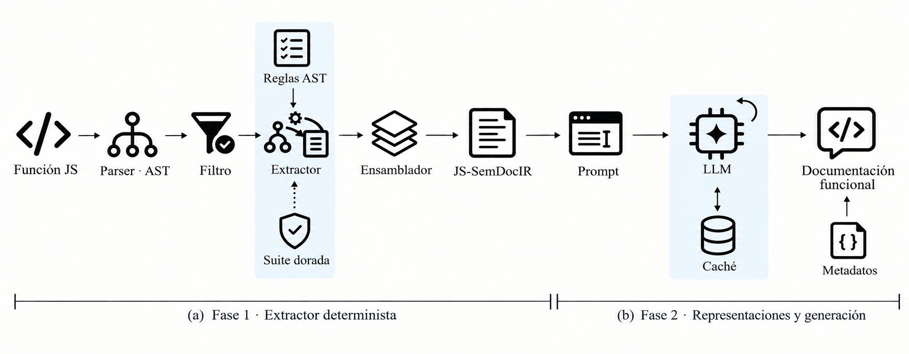

# JS-SemDocIR

Deterministic JavaScript AST extraction and representation pipeline for
functional documentation. The repository includes the Phase 1 extractor and a
local Phase 2 implementation scaffold:

```text
JavaScript source → parsed AST → admission filter → extractor → JS-SemDocIR (P)
```

## Pipeline



Phase 1 provides the deterministic parser, admission filter, extractor and
assembler. The local web app demonstrates that system path and displays only P.
B0 (source), B1 (SBT), and B2 (NIT) are comparison inputs implemented for the
future evaluation protocol; they are not sequential processing steps or outputs
of the user-facing system. The separate Phase 2 orchestration scaffold remains
mock-only; no real model provider is configured.

## Requirements

- Node.js 24 or newer
- npm

The parser version is intentionally frozen at `@babel/parser@8.0.7`.

## Install

```bash
npm install
```

## Development commands

```bash
npm test
npm run test:integration
npm run typecheck
npm run lint
npm run format:check
```

## Usage

### Interfaz web local

```bash
npm run app
```

Abre [http://127.0.0.1:4173](http://127.0.0.1:4173), pega la función y pulsa
**Procesar función**. La pantalla muestra el flujo implementado y la salida P;
**Cargar ejemplo** inserta `parseList`. B0/B1/B2 no se muestran porque son
controles de comparación del protocolo experimental. El servidor solo escucha
en el equipo local. La generación de comentarios no está configurada; no hace
llamadas externas ni produce documentación con un modelo. Para detenerlo,
pulsa `Ctrl+C` en la terminal.

También está disponible el modo terminal con `npm run demo`.

```ts
import { parseFunction } from './src/core/ast/index.ts';
import { assemble, extractFunction } from './src/core/semdocir/index.ts';

const source = [
  'async function getUser(id) {',
  '  const response = await fetch(`/api/users/${id}`);',
  '  return response.json();',
  '}',
].join('\n');

const instance = assemble(extractFunction(source, parseFunction(source)));
console.log(instance);
```

## Phase 2 local mock pipeline

See [`docs/design.md`](docs/design.md) for the module map and
[`docs/status.md`](docs/status.md) for what is implemented. A job can be run
without an external service:

```ts
import {
  GenerationService,
  MockGenerationClient,
  createRepresentationJobs,
  runRepresentationJob,
} from './src/evaluation/generation/index.ts';
import { buildRepresentationBundle } from './src/evaluation/representations/index.ts';

const bundle = buildRepresentationBundle('function identity(value) { return value; }', {
  sourceId: 'example:identity',
});
const jobs = createRepresentationJobs(bundle);
const service = new GenerationService(new MockGenerationClient());

// Each call runs exactly one function × representation job.
const result = await runRepresentationJob(jobs[0]!, service);
if (result.status === 'succeeded') {
  console.log(result.status, result.representation, result.response.output);
} else {
  console.error(result.status, result.representation, result.error.message);
}
```

The mock marker is not generated documentation. `protocol.json` intentionally
keeps provider/model unset and `allowRealApi` false pending approval.

## Implemented features

- Deterministic Babel AST parsing and admission filtering
- Function-frontier traversal for nested functions
- Conditions, loops, returns, throws, `try/catch/finally`, calls and `await`
- Source-preserving expressions with normalized whitespace and removed comments
- Canonical category ordering and bilateral absence markers
- Non-determinable (`ND`) records for supported local cases
- Expression expansion (I-F2.7-01): pure top-level assignments are substituted
  recursively in `RET`, `CALL`, and `COND` records, so P carries the full data
  flow of the function
- Exact unit tests for canonical examples and extraction edge cases
- Deterministic SBT and NIT serializers with golden fixtures
- Shared B0/B1/B2/P identity and artifact metadata
- Versioned mock-only request protocol, local file cache, bounded retries, and resumable records
- One-function × one-representation orchestration with an end-to-end mock integration test

## Scope and limitations

No real API client, credentials, model selection, corpus run, metric calculation,
human rubric, hypothesis testing, or experimental result is included. Generated
cache records are local, ignored by Git, and are not thesis evidence.

## Project structure

```text
src/core/ast/                    Parser, AST walk, admission, shared analysis
src/core/semdocir/               P extraction and canonical assembly
src/evaluation/representations/  B0/B1/B2/P comparison artifacts
  serializers/                   SBT and NIT encoders
src/evaluation/generation/       Jobs, protocol, mock client, cache
src/web/routes/                  Analysis and comparison HTTP routes
src/server.ts                    Local web server and route dispatch
src/cli.ts                       Terminal demo
docs/design.md             Module map, contracts and design rules
docs/status.md                   Implemented state and open gates
protocol.json                    Non-secret, mock-only draft protocol
test/                            Unit and mock integration tests
```

Each module is consumed through its `index.ts`; there are no compatibility
re-export layers. The core analysis parses once and is the only path that
builds P. The experimental comparator reuses that exact P and AST for B1/B2
serialization; the user-facing `/api/analyze` route remains separate from
`/api/compare`.

## License

This project is part of an academic thesis and is currently unpublished and
unlicensed.
