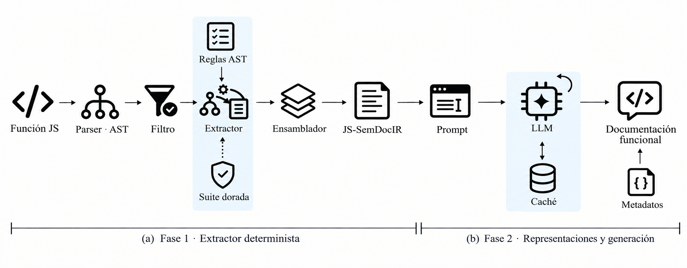

# JS-SemDocIR

**Documentación funcional determinista de funciones JavaScript.**

JS-SemDocIR es el artefacto de una tesis académica. Convierte una función
JavaScript en una representación estructurada de lo que hace —entradas,
condiciones, operaciones, manejo de errores y retornos— sin usar modelos de
lenguaje. El repositorio incluye además el instrumental del experimento: las
representaciones de comparación B0/B1/B2, un cliente de generación y los
resultados almacenados de la corrida completa con `gpt-5.3-codex`.

## Estado actual

| Componente                              | Estado                                               |
| --------------------------------------- | ---------------------------------------------------- |
| Parser, filtro de admisión y extracción | Completo                                             |
| Serializadores B1/SBT y B2/NIT          | Completo, con fixtures dorados                       |
| Interfaz web local                      | Completa: análisis, comparación y casos reales       |
| Corrida experimental                    | 2 056 funciones × 4 representaciones = 8 224 salidas |
| Métricas                                | BLEU-4, ROUGE-L y BERTScore para las 8 224 salidas   |
| Pruebas                                 | 169 pruebas en 32 suites                             |

El análisis, la vista de casos reales y los datos versionados funcionan sin
conexión. Solo la vista de comparación y `npm run experiment` pueden llamar a
un proveedor externo, y únicamente si existe un archivo `.env` configurado.

## Pipeline



```text
Fuente JavaScript → parser Babel → filtro de admisión → extractor → ensamblador → P
```

La salida del sistema es **P** (JS-SemDocIR), una representación canónica y
determinista. **B0** (código fuente), **B1** (SBT) y **B2** (NIT) no son pasos
del sistema: son las entradas de comparación del protocolo experimental.

## Requisitos e instalación

- Node.js 24 o superior
- npm

```bash
git clone https://github.com/juanhuamani/Js-SemdocIr
cd Js-SemdocIr
npm install
```

El parser está congelado en `@babel/parser@8.0.7` para preservar la
reproducibilidad de las representaciones.

## Inicio rápido

```bash
npm run app
```

Abre [http://127.0.0.1:4173](http://127.0.0.1:4173). El servidor escucha solo
en el equipo local y se detiene con `Ctrl+C`.

## Interfaz web

### Análisis de una función

Pega una función JavaScript y pulsa **Procesar función**. La vista muestra el
recorrido completo del pipeline y la representación P resultante. **Cargar
ejemplo** inserta la función `parseList` del corpus de referencia.

### Comparación B0/B1/B2/P

Genera las cuatro representaciones de una misma función. Cada tarjeta permite
enviar esa representación al proveedor configurado en `.env` y muestra la
respuesta, el modelo, los tokens y la latencia. Es una vista de prueba: no
escribe en la caché del experimento ni cuenta como evidencia. Sin `.env`
completa, la ruta responde `503` con la variable faltante.

### Casos reales (replay)

Ocho casos curados de la corrida completa: cuatro aciertos, dos casos difíciles
y dos desaciertos. Para cada uno se muestran:

- la entrada exacta en B0, B1, B2 y P;
- los parámetros congelados de la generación;
- la salida guardada y la referencia del dataset;
- BLEU-4, ROUGE-L, BERTScore, latencia y tokens;
- la traza de los pasos intermedios del pipeline.

La vista lee únicamente archivos locales y **no hace ninguna llamada al
modelo**. Los datos mínimos están versionados, por lo que un clon limpio puede
abrirla con `npm install && npm run app`.

## Protocolo experimental

| Elemento         | Valor                                                             |
| ---------------- | ----------------------------------------------------------------- |
| Dataset          | CodeXGLUE code-to-text, JavaScript test (3 291 → 2 056 admitidas) |
| Representaciones | B0, B1/SBT, B2/NIT y P                                            |
| Modelo           | `gpt-5.3-codex` mediante la OpenAI Responses API                  |
| Decodificación   | temperatura 0, `max_output_tokens` 128, `reasoning.effort = none` |
| Semilla          | No se envía; el endpoint la rechaza                               |
| Corrida          | 8 224 llamadas, sin fallos de ejecución                           |
| Métricas         | BLEU-4 suavizado, ROUGE-L F1 y BERTScore F1                       |

El prompt y el bloque del corpus viven en `protocol.json`; los parámetros de la
corrida Codex se aplican en el cliente Responses. La consigna pide una sola
frase de 25 palabras como máximo. El detalle de las decisiones metodológicas
está en `docs/10-protocolo/` del repositorio de la tesis.

## Reproducción

### Corpus y representaciones

```bash
npm run corpus
```

Descarga la partición de CodeXGLUE, aplica el filtro de admisión, genera las
representaciones B0/B1/B2/P y verifica los digests del corpus congelado.
Requiere conexión a Internet. Los artefactos quedan en `corpus/`.

### Generación

La corrida completa requiere una clave de OpenAI y presupuesto para 8 224
llamadas:

```bash
cp .env.example .env
npm run experiment -- --provider responses --out experimento/salidas-codex-repeticion.jsonl
```

El comando reutiliza la caché local cuando la clave de petición coincide. No se
ejecuta en las pruebas ni en integración continua.

### Métricas

Los scripts de `scripts/metrics/` recalculan las métricas contra el docstring
del corpus:

```bash
python scripts/metrics/bleu.py --experiment experimento/salidas-codex.jsonl --out experimento/metricas-repeticion/bleu.jsonl
python scripts/metrics/rouge.py --experiment experimento/salidas-codex.jsonl --out experimento/metricas-repeticion/rouge.jsonl
python scripts/metrics/bertscore.py --experiment experimento/salidas-codex.jsonl --out experimento/metricas-repeticion/bertscore.jsonl
```

Requieren un entorno Python con `sacrebleu`, `rouge-score` y `bert-score`
(este último descarga un modelo de lenguaje y puede usar GPU).

## Datos versionados

Para que la vista de casos reales sea reproducible sin claves, el repositorio
incluye un paquete mínimo:

- `corpus/admitido.jsonl`: las 2 056 funciones admitidas con su docstring.
- `experimento/salidas-codex.jsonl`: las 8 224 salidas de la corrida completa.
- `experimento/metricas-codex-full/`: BLEU, ROUGE y BERTScore de esas salidas.
- `corpus/repr/{b0,b1,b2,p}/`: las 32 representaciones de los ocho casos curados.

El resto de artefactos —corpus crudo, AST, caché, otros pilotos y métricas
auxiliares— está ignorado por Git. Se regenera con los comandos anteriores o se
conserva como evidencia local del experimento.

## Uso programático

```ts
import { parseFunction } from './src/core/ast/index.ts';
import { assemble, extractFunction } from './src/core/semdocir/index.ts';

const source = [
  'async function getUser(id) {',
  '  const response = await fetch(`/api/users/${id}`);',
  '  return response.json();',
  '}',
].join('\n');

const instance = assemble(extractFunction(source, parseFunction(source)));
console.log(instance);
```

El modo terminal está disponible con:

```bash
npm run demo
```

## Estructura del proyecto

```text
src/core/ast/                  Parser Babel, recorrido, admisión y análisis compartido
src/core/semdocir/             Extracción de P y ensamblado canónico
src/representations/           Artefactos B0/B1/B2/P y serializadores SBT/NIT
src/generation/                Protocolo, clientes, caché, reintentos y orquestación
src/interfaces/http/           Servidor local, rutas y carga de casos reales
src/interfaces/cli.ts          Demostración por terminal
ui/index.html                  Interfaz web de una sola página
scripts/                       Corpus, experimento y métricas
corpus/                        Corpus admitido y representaciones (parcial)
experimento/                   Salidas y métricas de la corrida (parcial)
test/                          Pruebas unitarias y de integración
docs/                          Contexto, arquitectura y estado del proyecto
images/                        Diagramas
```

Cada módulo se consume a través de su `index.ts`. El análisis sintáctico se
hace una sola vez y es la única ruta que construye P; el comparador reutiliza
ese mismo AST y esa misma P para serializar B1 y B2.

## Desarrollo y pruebas

```bash
npm test
npm run test:integration
npm run typecheck
npm run lint
npm run format:check
npm run check:size
```

`npm test` ejecuta la suite completa con el runner nativo de Node. El proyecto
limita cada archivo TypeScript a 300 líneas mediante `npm run check:size`.

## Configuración

Copia la plantilla y completa solo las claves que vayas a usar:

```bash
cp .env.example .env
```

| Variable                 | Uso                                                          |
| ------------------------ | ------------------------------------------------------------ |
| `COMMANDCODE_API_KEY`    | Proveedor CommandCode (Chat Completions).                    |
| `COMMANDCODE_BASE_URL`   | Endpoint compatible con OpenAI, incluida la ruta `/v1`.      |
| `COMMANDCODE_TIMEOUT_MS` | Tiempo máximo por llamada; por defecto 60 000 ms.            |
| `OPENAI_API_KEY`         | OpenAI Responses API, usada por los modelos Codex.           |
| `OPENAI_BASE_URL`        | Endpoint de OpenAI; por defecto `https://api.openai.com/v1`. |
| `OPENAI_MODEL`           | Modelo de reserva; por defecto `gpt-5.3-codex`.              |

`.env` está ignorado por Git y nunca debe versionarse. `protocol.json` no
contiene credenciales: el validador rechaza cualquier campo con nombre de
secreto.

## Alcance y limitaciones

- El análisis cubre una función de forma aislada; no resuelve enlaces entre
  módulos ni la semántica externa de las llamadas.
- La vista de comparación es una sonda interactiva, no evidencia experimental.
- El repositorio contiene resultados descriptivos y sus métricas, pero no
  pruebas de hipótesis ni la rúbrica de evaluación humana.
- El proyecto es académico, no publicado y no tiene licencia.

## Documentación

- [`docs/design.md`](docs/design.md): mapa de módulos, contratos y reglas de diseño.
- [`corpus/SOURCE.md`](corpus/SOURCE.md): procedencia y licencia del corpus.
- [`corpus/MANIFIESTO.md`](corpus/MANIFIESTO.md): artefactos, digests y parámetros congelados.
