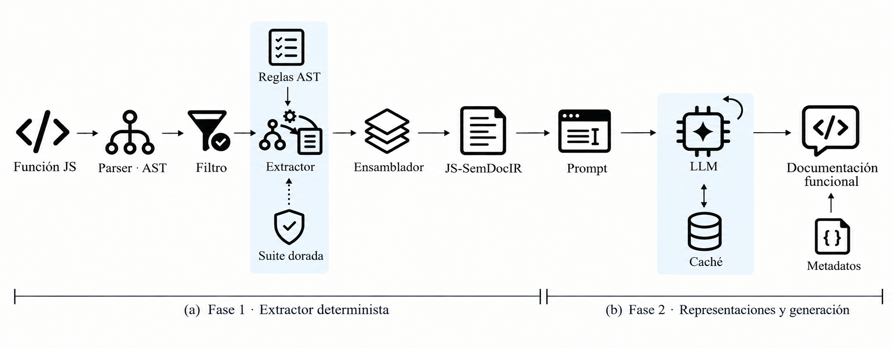

# JS-SemDocIR

Deterministic JavaScript AST extraction and representation pipeline for
functional documentation. The repository includes the Phase 1 extractor and a
local Phase 2 implementation scaffold:

```text
JavaScript source → one parsed AST → admission filter → B0/B1/B2/P → one-representation job → mock client
```

## Pipeline



Phase 1 provides the deterministic parser, admission filter, extractor and
assembler. The Phase 2 local implementation builds B0 (original source), B1 (SBT),
B2 (NIT), and P (JS-SemDocIR), then exercises one representation per job. Its
default client is a deterministic mock; no real model provider is configured.

## Requirements

- Node.js 24 or newer
- npm

The parser version is intentionally frozen at `@babel/parser@8.0.7`.

## Install

```bash
npm install
```

## Development commands

```bash
npm test
npm run test:integration
npm run typecheck
npm run lint
npm run format:check
```

## Usage

### Interfaz web local

```bash
npm run app
```

Abre [http://127.0.0.1:4173](http://127.0.0.1:4173), pega la función y pulsa
**Procesar función**. Puedes cambiar entre las pestañas B0, B1, B2 y P, y copiar
el resultado de la pestaña activa. El botón **Cargar ejemplo** inserta una
función de demostración. El servidor solo escucha en el equipo local y utiliza
el cliente mock; no hace llamadas de red ni genera documentación real. Para
detenerlo, pulsa `Ctrl+C` en la terminal.

También está disponible el modo terminal con `npm run demo`.

```ts
import { assemble } from './src/assembler.ts';
import { extractFunction } from './src/extractor.ts';
import { parseFunction } from './src/parse.ts';

const source = [
  'async function getUser(id) {',
  '  const response = await fetch(`/api/users/${id}`);',
  '  return response.json();',
  '}',
].join('\n');

const instance = assemble(extractFunction(source, parseFunction(source)));
console.log(instance);
```

## Phase 2 local mock pipeline

See [`docs/phase2.md`](docs/phase2.md) for representation, request, cache,
retry, and recovery contracts. A job can be run without an external service:

```ts
import { GenerationService } from './src/client/generation-service.ts';
import { MockGenerationClient } from './src/client/mock.ts';
import { createRepresentationJobs, runRepresentationJob } from './src/orchestrator.ts';
import { buildRepresentationBundle } from './src/representations.ts';

const bundle = buildRepresentationBundle('function identity(value) { return value; }', {
  sourceId: 'example:identity',
});
const jobs = createRepresentationJobs(bundle);
const service = new GenerationService(new MockGenerationClient());

// Each call runs exactly one function × representation job.
const result = await runRepresentationJob(jobs[0]!, service);
if (result.status === 'succeeded') {
  console.log(result.status, result.representation, result.response.output);
} else {
  console.error(result.status, result.representation, result.error.message);
}
```

The mock marker is not generated documentation. `protocol.json` intentionally
keeps provider/model unset and `allowRealApi` false pending approval.

## Implemented features

- Deterministic Babel AST parsing and admission filtering
- Function-frontier traversal for nested functions
- Conditions, loops, returns, throws, `try/catch/finally`, calls and `await`
- Source-preserving expressions with normalized whitespace and removed comments
- Canonical category ordering and bilateral absence markers
- Non-determinable (`ND`) records for supported local cases
- Exact unit tests for canonical examples and extraction edge cases
- Deterministic SBT and NIT serializers with golden fixtures
- Shared B0/B1/B2/P identity and artifact metadata
- Versioned mock-only request protocol, local file cache, bounded retries, and resumable records
- One-function × one-representation orchestration with an end-to-end mock integration test

## Scope and limitations

No real API client, credentials, model selection, corpus run, metric calculation,
human rubric, hypothesis testing, or experimental result is included. Generated
cache records are local, ignored by Git, and are not thesis evidence.

## Project structure

```text
src/parse.ts           Frozen Babel parser wrapper
src/filter.ts          Admission filter
src/extractor.ts       Semantic record extraction
src/assembler.ts       Canonical JS-SemDocIR assembly
src/serializers/       SBT and NIT serializers
src/representations.ts B0/B1/B2/P contract and stable IDs
src/client/            Mock client, cache, retries, and recovery
src/orchestrator.ts    One function × one representation per job
protocol.json          Non-secret, mock-only draft protocol
test/                  Unit and mock integration tests
```

## License

This project is part of an academic thesis and is currently unpublished and
unlicensed.
